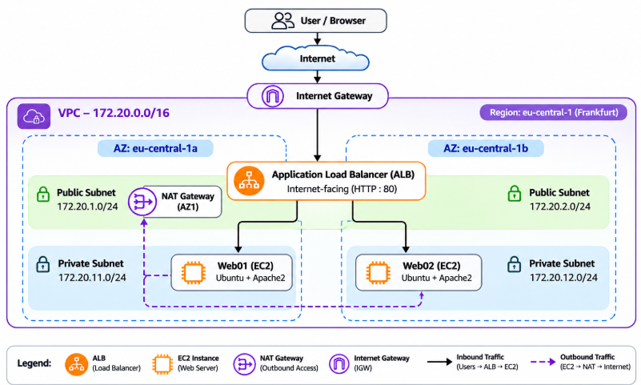
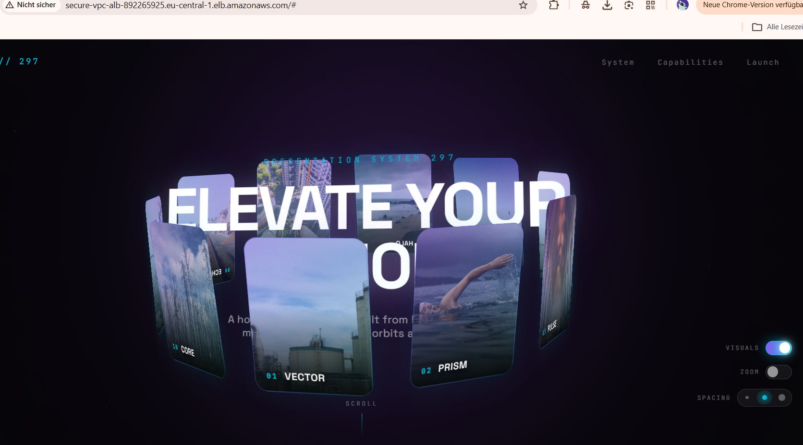
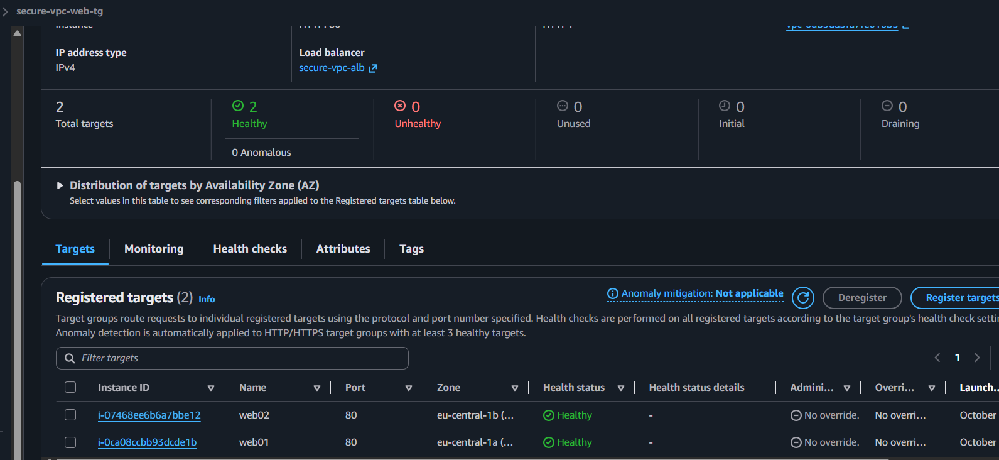
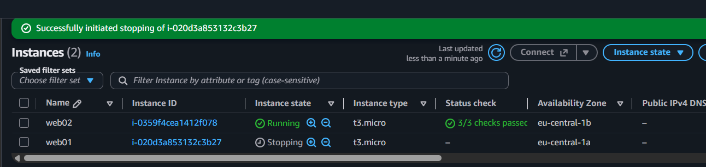
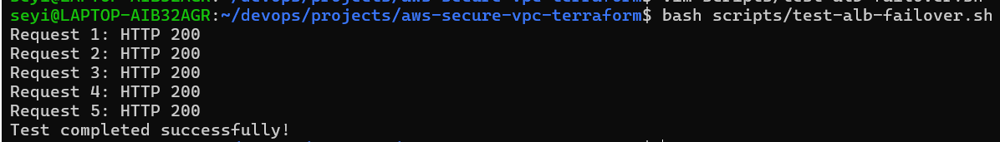

# AWS Secure VPC Infrastructure with Terraform

**A secure, multi-AZ AWS web infrastructure built with Terraform, private EC2 instances, Apache2, and an Application Load Balancer.**

This project demonstrates how Infrastructure as Code (IaC) can automate the deployment of a secure AWS network, host a web application across two Availability Zones, and maintain application availability when one web server becomes unavailable.

**Tech Stack:** AWS | Terraform | Ubuntu | Apache2 | Bash | Git & GitHub

---

## 1. The Problem: A Real-World Scenario

Imagine a growing business preparing to launch a customer-facing website.

The website needs to remain accessible even if one server fails. At the same time, the business wants to avoid exposing its backend servers directly to the internet and reduce the effort of manually provisioning infrastructure.

**The challenge:** How can we build a secure, repeatable, and resilient web hosting environment while keeping infrastructure costs under control?

### My Approach

I designed and deployed an AWS environment using Terraform, featuring:

- A custom VPC with public and private subnets across two Availability Zones.
- Two private Ubuntu EC2 instances running Apache2.
- An internet-facing Application Load Balancer (ALB) distributing traffic between the servers.
- A NAT Gateway providing outbound internet access to private instances.
- Security Groups restricting direct access to the backend servers.
- Automated website deployment and Bash-based availability testing.

The infrastructure can be created, modified, and destroyed using Terraform rather than configuring each resource manually.

## 2. Architecture & Design Decisions

****

*AWS region: eu-central-1 (Frankfurt)*

| Component | Configuration |
|---|---|
| VPC | `172.20.0.0/16` |
| Public Subnets | `172.20.1.0/24` and `172.20.2.0/24` |
| Private Subnets | `172.20.11.0/24` and `172.20.12.0/24` |
| Availability Zones | `eu-central-1a` and `eu-central-1b` |
| Web Servers | 2 × Ubuntu EC2 (`t3.micro`) |
| Load Balancer | Internet-facing ALB, HTTP port 80 |
| NAT Gateway | One zonal NAT Gateway in AZ1 |

### How Traffic Flows

**Inbound application traffic:**

`Internet → ALB → Healthy EC2 Target`

The ALB receives public HTTP requests and forwards them to healthy EC2 instances in private subnets. Neither web server requires a public IPv4 address.

**Outbound application traffic:**

`Private EC2 → NAT Gateway → Internet Gateway → Internet`

The NAT Gateway allows private instances to download packages and website files without accepting unsolicited inbound internet connections.

### Why Only One NAT Gateway?

Although the web servers run across two Availability Zones, I deliberately deployed a single NAT Gateway in AZ1.

The reason was **cost optimization**. For a short-lived learning environment, provisioning a NAT Gateway in every AZ would increase costs.

However, this introduces a trade-off: both private subnets depend on the NAT Gateway in AZ1 for outbound internet connectivity.

In a production environment, I would use NAT Gateways in each AZ with appropriate routing, or evaluate a regional NAT solution for greater resilience.

**Key takeaway:** Multi-AZ application deployment improves availability, but every supporting network dependency must also be considered.

## 3. Infrastructure & Application Automation

Terraform provisions the VPC, subnets, routing, Internet Gateway, NAT Gateway, Security Groups, EC2 instances, and ALB.

I organized the networking infrastructure into a **custom Terraform VPC module**, making the configuration easier to maintain and reuse.

### Project Structure

```text
aws-secure-vpc-terraform/
├── modules/
│   └── vpc/                 # VPC and networking resources
├── scripts/
│   ├── user-data.sh         # Automated website installation
│   └── test-alb-failover.sh # Availability testing
├── screenshots/            # Infrastructure evidence
├── diagrams/               # Architecture diagram
├── main.tf
├── providers.tf
├── versions.tf
├── variables.tf
├── security.tf
├── ec2.tf
├── alb.tf
├── outputs.tf
└── README.md
```

### Automated Website Deployment

Instead of manually installing software on each EC2 instance, I used a Bash `user_data` script that runs during initial provisioning.

The script automatically:

1. Updates Ubuntu package information.
2. Installs Apache2, curl, and unzip.
3. Downloads and extracts a [Tooplate](https://www.tooplate.com/) website template.
4. Deploys the website to `/var/www/html/`.
5. Configures a `/health` endpoint and starts Apache2.

Terraform uses the same script to configure both private web servers, keeping their application setup consistent.

*Website template credit: Tooplate. Template source assets are not redistributed in this repository.*

## 4. Testing & Results

A successful Terraform deployment doesn't necessarily mean the application is working. I validated both infrastructure health and application availability.

### Website and Target Health

The website successfully loaded through the ALB's public DNS name, and the `/health` endpoint returned a successful response.

****

****

### High-Availability Failover Test - PASSED

To verify application availability during an instance failure, I deliberately stopped **Web01**, leaving Web02 running in the second Availability Zone.

I then checked the ALB target group and used a Bash script to send five HTTP requests.
****

```bash
bash scripts/test-alb-failover.sh
```

**Observed results:**

| Test | Result |
|---|---|
| Website accessible through ALB | Passed |
| Both targets initially healthy | Passed |
| Web01 stopped to simulate failure | Completed |
| Web02 remained healthy | Passed |
| Five requests returned HTTP 200 | Passed |
| Website remained accessible | Passed |

****

The test confirmed that the ALB could continue routing requests to the remaining healthy server after Web01 became unavailable.

This demonstrates application-level failover, although it does not measure zero-downtime failover or full disaster-recovery capability.

## 5. Challenges & Lessons Learned

Beyond deploying infrastructure, this project involved troubleshooting Terraform, understanding resource dependencies, and making cost-conscious design decisions.

| Challenge | Lesson Learned |
|---|---|
| Terraform provider startup timeout and state-lock messages during development | Provider errors and state handling require careful investigation rather than repeatedly retrying commands. |
| Updating EC2 user data for the website | First-boot configuration changes can trigger EC2 replacement, so reviewing `terraform plan` is essential. |
| Managing infrastructure costs during breaks | I used `terraform destroy` between sessions and recreated the environment when ready to continue. |
| Using one NAT Gateway across two AZs | Reducing infrastructure costs can introduce availability dependencies that must be documented. |
| Keeping backend servers private | Security Group references and ALB target groups provide controlled application access without public EC2 IPs. |

One of the most valuable lessons was learning to look beyond whether Terraform reported a successful deployment.

**Infrastructure must also be tested, secured, monitored, and designed with failure in mind.**

## 6. Limitations & Production Improvements

This was intentionally designed as a small, cost-conscious infrastructure project rather than a production-ready platform.

If I were extending it for a real business, my priorities would be:

| Area | Recommended Improvement |
|---|---|
| High Availability | Resilient NAT connectivity across AZs and an EC2 Auto Scaling Group for automatic instance replacement |
| Security | HTTPS using AWS Certificate Manager, tighter egress controls, and secure management through AWS Systems Manager |
| Monitoring | Amazon CloudWatch metrics, application logs, health alarms, and operational alerts |
| Terraform State | Remote state storage with appropriate access controls and state locking |
| Deployment Automation | CI validation and a controlled process for application updates |

These improvements would increase resilience, security, and operational maturity, but were intentionally outside the scope of this version.

## 7. Deployment & Cleanup

### Prerequisites

- Terraform installed
- AWS CLI configured with suitable AWS credentials
- AWS permissions to provision the required resources
- A valid direct HTTPS download URL for the chosen Tooplate template

### Deploy the Infrastructure

Clone the repository:

```bash
git clone https://github.com/seyi35/aws-secure-vpc-terraform.git
cd aws-secure-vpc-terraform
```

Create a local `terraform.tfvars` file containing the website template URL:

```hcl
tooplate_download_url = "YOUR_DIRECT_TEMPLATE_ZIP_URL"
```

Initialize and deploy:

```bash
terraform init
terraform fmt -recursive
terraform validate
terraform plan
terraform apply
```

Once provisioning is complete, retrieve the ALB DNS name:

```bash
terraform output -raw alb_dns_name
```

Open the returned address using `http://` to access the website.

### Cleanup & Cost Management

The NAT Gateway, public IPv4 address, EC2 instances, EBS volumes, and ALB may incur AWS charges while provisioned.

After testing, destroy the infrastructure:

```bash
terraform destroy
```

Review the destruction plan, approve it, and verify in the AWS Console that the project's billable resources have been deleted.

This project reinforces one of the benefits of IaC: **the same infrastructure can be recreated when needed and removed when no longer required.**

---

## Final Thoughts

This project strengthened my practical experience with Terraform modules, AWS networking, Linux automation, Security Groups, load balancing, and application availability testing.

The biggest takeaway wasn't simply getting the website online. It was understanding how different AWS components work together, how architecture decisions affect cost and resilience, and why testing failure scenarios matters.

**A successful deployment is only the beginning. Understanding how the infrastructure behaves when something goes wrong is where real engineering begins.**

**Built with:** AWS · Terraform · Ubuntu · Apache2 · Bash · Git · GitHub
